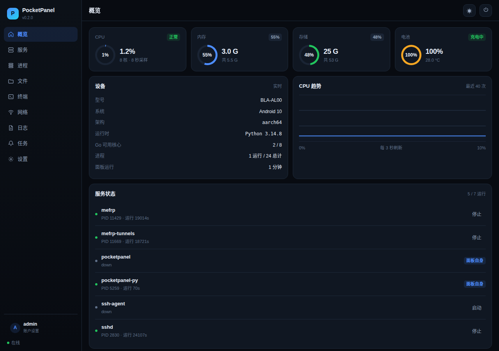
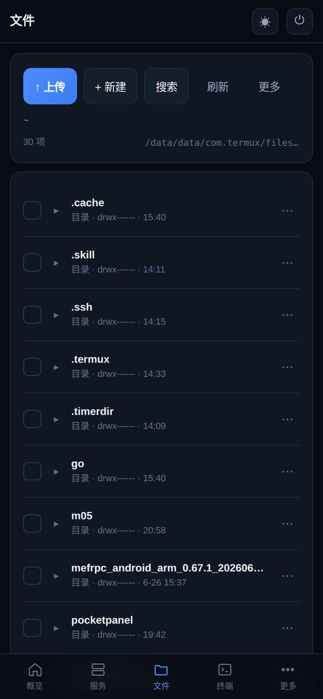
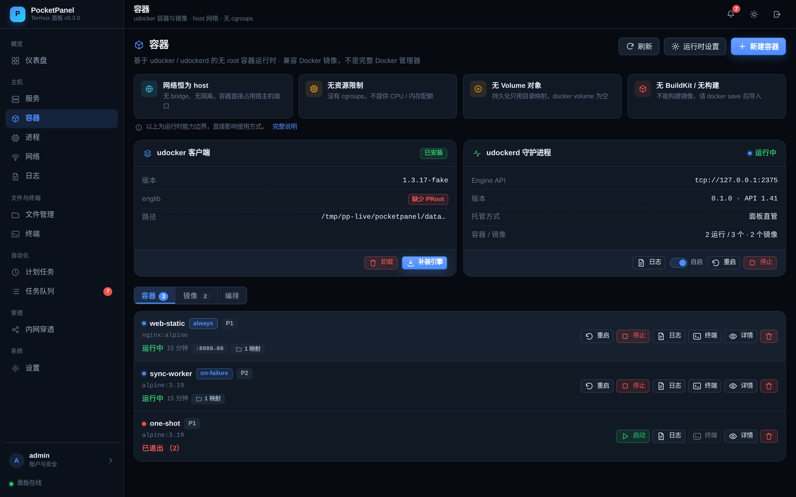
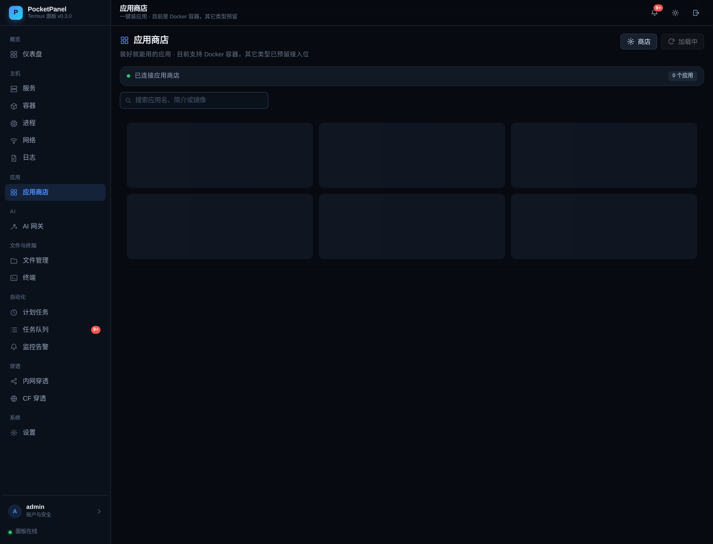

# PocketPanel · Python + Vue 3 版

[](https://github.com/sanhe458/PocketPanel)
[](#license)

把闲置的 Android 手机变成一台可远程管理的小主机。运行在 **华为 BLA-AL00（Mate 10 / Android 10 / Termux / aarch64 / 无 root）** 上——不是模拟器，是抽屉里那台 2017 年的手机。
后端 Python 3.14 标准库，前端 Vue 3 + Vite 构建产物，runit 托管。



<p align="center">
  
  
</p>

<p align="center">
  
</p>

## 访问

| 项 | 值 |
|---|---|
| 局域网地址 | `http://<手机IP>:8888` |
| 用户名 | `admin` |
| 密码 | 首次启动时随机生成并打印在控制台（同时写入 `data/config.json` 的 `init_pwd`） |
| 会话 | HttpOnly Cookie，24 小时 |

首次启动的终端长这样，密码只打印这一次，登录后请立刻改掉：

```text
========================================
 首次启动，已生成登录账号
 用户名: admin
 密  码: xxxxxxxxxx
 请登录后立即修改
========================================
```

不在同一局域网时走 SSH 隧道（端口、用户名、主机换成你自己的）：

```bash
ssh -p <SSH端口> -L 8888:127.0.0.1:8888 <用户名>@<主机>
# 浏览器打开 http://127.0.0.1:8888
```

## 技术栈与资源占用

| 项 | 数值 |
|---|---|
| 后端 | Python 3.14.8，**零第三方依赖**（标准库 http.server / threading / pty / fcntl） |
| 前端 | Vue 3.5 + xterm.js 6，按路由代码分割：`app.js` 153KB（gzip **56KB**）、`style.css` 45.7KB（gzip 10.6KB），终端页 xterm 独立为 356KB chunk 按需加载 |
| 常驻内存 | **24.9 MB**（无会话时） |
| 线程数 | 4（主线程 + CPU 采样 + 定时清理 + 会话回收）；每个终端 +1 读线程，每条 WebSocket 再 +2 |
| 启动耗时 | 746 ms（只影响一次启动） |
| 单请求延迟 | 2–4 ms |
| 磁盘占用 | 代码 112KB + 静态资源 596KB + Python 运行时 45MB |

设备总内存 5.6GB、可用 2.4GB，24.9MB 占 0.44%。前端重构后按路由做了代码分割：首屏只加载
`app.js`（153KB / gzip 56KB）+ `style.css`（45.7KB / gzip 10.6KB），xterm.js 被拆到独立的
356KB chunk，只有进入终端页才拉取。产物文件名带内容 hash，手机浏览器一次加载后走强缓存。

### 前端设计系统

界面参照宝塔与 1Panel 的信息架构重做，不是简单换色：

- **分组侧栏**：`nav.js` 定义「概览 / 主机 / 文件与终端 / 自动化 / 系统」五组导航，每项带图标与描述；
  移动端收进底部 5 个 tab + 「更多」抽屉。
- **页头与面包屑**：`.page-head` + `.crumb`，每个页面有标题、说明和右上角操作区。
- **紧凑数据表格**：`table.tbl` sticky 表头、行 hover、右对齐操作列 `.tbl-ops`，统一由 `DataTable.vue` 封装。
- **指标卡**：`StatCard.vue`，CPU / 内存 / 存储 / 电池等按阈值切换语义色与进度条。
- **统一图标库**：`icons.js` 收录约 90 个 24×24 线性 SVG path，替代早先的 Unicode 字符图标。
- **浮层栈**：`overlay.js` 统一管理 Modal 与 Sheet 的层级，Esc 只关闭最上层浮层。
- **Design Token**：颜色 / 圆角 / 阴影 / 间距全部走 CSS 变量，深浅主题由 `[data-theme]` 覆盖。
- **hash 路由**：URL 形如 `/#/files`，切换页面走组件级替换 + 150ms 淡入（宝塔式无整页刷新）；
  刷新 / 分享链接 / 浏览器前进后退都能直达对应页面，未登录访问带路径的链接时登录后自动落位；
  异步页（终端 / 文件 / 穿透）chunk 加载超过 150ms 才显示骨架 loading。

## 部署

### 从仓库拉代码

```bash
pkg install -y python nodejs-lts openssh   # python 约 45MB，openssh 供 SSH 终端使用
git clone https://github.com/sanhe458/PocketPanel.git ~/pocketpanel-py
cd ~/pocketpanel-py/web && npm install && npm run build   # 产物输出到 ../static
cd .. && python3 app.py                                   # 首次启动打印账号密码
```

`static/` 是构建产物，不入库。**clone 后必须先 `npm run build` 一次**，否则页面 404。
不装 Node 也行：在别的机器上 build，把整个 `static/` 拷过来。

### 装成服务（runit）

runit 服务 `$PREFIX/var/service/pocketpanel-py/run`：

```sh
#!/data/data/com.termux/files/usr/bin/sh
export HOME=/data/data/com.termux/files/home
export PREFIX=/data/data/com.termux/files/usr
export PATH=$PREFIX/bin:$PATH
cd $HOME/pocketpanel-py || exit 1
exec python3 app.py 2>&1
```

```bash
chmod +x $PREFIX/var/service/pocketpanel-py/run
sv up pocketpanel-py
```

### 更新后端

```bash
scp -P <SSH端口> core.py metrics.py files.py share.py term.py app.py \
      gateway.py gateway_ir.py secretbox.py <用户名>@<主机>:~/pocketpanel-py/
ssh -p <SSH端口> <用户名>@<主机> 'sv restart pocketpanel-py'
```

Python 没有编译产物锁定，直接覆盖即可（`.new + mv` 是 Go 版才需要的 ETXTBSY 规避）。

> 用了 AI 网关就三个文件都要传：`gateway.py`（路由与转发）、`gateway_ir.py`（协议转换）、
> `secretbox.py`（密钥加解密）。少任何一个 `app.py` 会在启动时 ImportError。
> `data/secret.key` 和 `data/gateway.db` 在 `~/pocketpanel/data/` 下，**别删**——
> 删了 secret.key，已存的 Key 就解不开了。

### 更新前端

```bash
cd web && npm run build          # 产物在 ../static，文件名带内容 hash
scp -P <SSH端口> -r ../static <用户名>@<主机>:~/pocketpanel-py/
```

## 目录结构

```
pocketpanel-python/
├── core.py       配置、会话、任务队列、路径沙箱、通用工具
├── metrics.py    CPU/内存/磁盘/电池、服务、进程、网络、日志
├── files.py      文件 CRUD、回收站、历史版本、收藏、搜索、压缩、分片上传
├── share.py      分享链接、提取码、公开页
├── term.py       PTY 会话（bash/sh/自定义命令）、SSH 主机簿、askpass
├── sched.py      cron 解析、内置调度器、执行历史、失败通知
├── tasktypes.py  任务类型注册中心（schema/校验/执行器；shell、服务、清理日志、访问 URL）
├── tunnel.py     内网穿透：frpc 配置解析/生成/三层校验、进程保活、公网拨测
├── cloudflare.py Cloudflare Tunnel：quick/named 两种形态、CF API 建隧道、Termux 运行包装
├── netguard.py   网络守卫：网络变动检测、防抖、隧道探测与智能恢复
├── alerts.py     监控告警：SMTP 发信与凭据加密、告警状态机、探活、系统联动、事件历史
├── messages.py   消息中心（后台事件收集）
├── svc.py        服务管理器（runit / 直管双适配器，pid 接管、僵尸识别、指数退避保活）
├── udocker_install.py  udocker 一键安装（客户端 + englib，镜像源测速 + 安全解包）
├── udockerd.py   Docker Engine API 守护进程（HTTP 服务，把请求翻译成 udocker 命令）
├── dockerclient.py     Engine API 客户端（标准库实现，零依赖）
├── runtime.py    ContainerRuntimeAdapter：能力边界、参数校验、任务、事件监控
├── compose.py    docker-compose 子集解析与编排（手写 YAML、.env 插值、拓扑排序）
├── appstore.py   应用商店：远程清单三级降级、类型注册表、按类型分派安装
├── catalog.py    商店清单（唯一真相源）：15 个应用的定义、分类表、版本号
├── gateway.py    AI 网关：Provider 存储、模型路由、零拷贝透传、跨协议转换、用量统计
├── gateway_ir.py AI 网关协议转换核心：四协议 ↔ IR 中间表示、请求/响应/流式三层编解码
├── secretbox.py  密钥盒：secret.key 生成、HMAC-CTR + EtM 加解密、掩码
├── app.py        HTTP 服务、路由表、认证、静态资源、文件流、WebSocket 入口
├── ws.py         RFC 6455 最小实现（终端实时通道）
├── static/       Vue 构建产物（index.html + assets/）
└── web/          前端源码（Vite 工程）
    ├── index.html
    ├── vite.config.js
    └── src/
        ├── App.vue        应用外壳：登录、分组侧栏、顶栏、消息中心、移动端 tabbar
        ├── api.js         接口封装、分片上传、任务轮询
        ├── cron.js        cron 引擎（与 sched.py 同语义，表单本地预览用）
        ├── store.js       全局状态与 toast
        ├── nav.js         导航信息架构（分组 + 图标 + 描述）
        ├── icons.js       SVG 图标库（ICONS path map + icon()）
        ├── overlay.js     浮层栈，Esc 只关闭最上层
        ├── style.css      Design Token + 组件样式（深浅双主题）
        ├── components/    Icon / Modal / Panel / Sheet / DataTable / StatCard
        │                  / EmptyState / TermView（xterm 实例）
        └── views/         Overview / Services / Processes / Files / Terminal
                           Schedule / Network / Logs / Tasks / Tunnels / Docker
                           / AppStore / Cloudflare / Gateway / Alerts / Settings
```

## 功能

| 模块 | 能力 |
|---|---|
| 账户 | 用户名 + 密码登录、改名改密、旧会话失效 |
| 概览 | CPU / 内存 / 存储 / 电池 / 温度 / 进程数 / 面板运行时长 / CPU 曲线 |
| 服务 | runit 列表、启停重启、面板自身保护 |
| 进程 | 内存排序、完整命令行、结束进程、关键进程保护 |
| 文件 | 分片上传（断点续传）、下载（Range）、新建/重命名/复制/移动、回收站、历史版本、在线编辑、搜索、压缩解压、分享、远程下载、权限、收藏、终端联动 |
| 终端 | **PTY 真终端**：bash / sh / 自定义命令、多标签、全屏、断线续屏、移动端快捷键条、**WebSocket 实时通道 + 长轮询兜底** |
| SSH | 密码 / 密钥登录远程主机、主机簿、私钥导入、known_hosts 复用 |
| 网络 | 接口信息、20 个本地端口的可连性探测 |
| 日志 | runit 日志尾读，100–1000 行 |
| 任务 | 异步任务列表、进度、输出 |
| 计划 | **内置调度器 + 多类型任务注册中心**：简易模式 + Cron 双路径、本地实时预览、手动运行、执行历史（结构化结果）、并发保护、息屏补跑、失败通知进消息中心。已注册类型：Shell 命令 / 服务控制 / 清理日志（dry-run、白名单、保留策略、单次上限）/ 访问 URL（方法/请求头/请求体/期望状态码/关键字校验/TLS/重试/脱敏） |
| 穿透 | **内网穿透（M15 Client 层）**：frpc 隧道实例托管（FreeFrp 预设 / 自建 FRPS / 粘贴导入三种创建方式）、TOML/JSON/INI 自动识别与按版本生成、三层校验（语法 → Schema → `frpc verify`）、raw/表单双模式（token 打码 + 保存自动回填）、进程保活（指数退避 1s→60s、连败 10 次告警）、公网拨测（60s 一轮、连败 3 次进消息中心、恢复通知）、面板端口穿透拦截、外部穿透进程只读探测（mefrp 等，含 WebUI 入口）、**frpc 一键安装**（Termux pkg / GitHub Release 双源，自动选架构 + SHA256 校验，内置 ghfast.top 等镜像源、并发测速自动选最快、支持自定义镜像）。**Cloudflare Tunnel**：临时地址（免账号 trycloudflare）/ 固定域名（CF API 自动建隧道 + ingress + CNAME）、cloudflared 一键安装（镜像并发探测 + 失败自动换源）、Termux 下自动套 proot 绑 resolv.conf + 指 CA |
| 容器 | **容器运行时（M17，无 root）**：基于 udocker / udockerd 兼容 Docker 镜像生态。镜像拉取（按平台选 ARM64）/ 导入（docker save 产物）/ 删除、容器创建与启停重启删、日志 tail、**exec 进容器复用 Web 终端**、bind mount 目录选择器、host 网络端口登记（<1024 拦截）、重启策略（no/always/on-failure）、**P1/P2/F1 执行模式**、异常退出进消息中心、udocker 一键安装与守护进程托管、compose 子集一键起。**四条边界在 UI 常驻展示**：host 网络 / 无 cgroups / 无 Volume 对象 / 无 BuildKit |
| 应用商店 | **独立板块（M07）**：远程清单（Cloudflare Worker + KV，三级降级）→ 卡片浏览 / 搜索 / **分类 + 类型双筛选** → 详情弹窗里填端口一键装。**上架 12 个应用，全部真机验证过**（Nginx / OpenList / Syncthing / Navidrome / Gitea / Redis / Uptime Kuma / Memos / Vaultwarden / Gotify / Alpine / New API），端口写死的应用会锁住输入框。类型走注册表，当前 `docker`（复用容器运行时），`termux` / `binary` / `script` 已登记待接入；清单里出现不认识的类型不会丢，只标「不支持」 |
| 消息 | 顶栏铃铛 + 未读徽标，后台事件（任务完成/失败/隧道告警/容器异常退出）统一收集 |
| AI 网关 | **轻量大模型 API 聚合与转发网关（M16）**：多 Provider 管理（名称 / Base URL / API Key / 支持协议多选 / 模型映射 / 通配兜底）、**Key 加密入库（HMAC-CTR + EtM，日志与接口只回掩码）**、全局访问 Token（`sk-pp-` 前缀，Bearer / `x-api-key` / `x-goog-api-key` / `?key=` 四种带法）、**四协议互通**（OpenAI Chat / OpenAI Responses / Anthropic / Gemini）+ IR 中间表示（系统提示 / 工具调用 / 工具结果的严格 id 匹配）、**同协议字节级透传**（只改 model 与认证，流式直接转发原始 SSE 不解析再序列化）、**大请求体零拷贝**（4KB 探针解析 + 生成器直传，20MB 图片透传内存只涨 0.76MB；50MB / 10MB 双上限，跨协议超大请求体 413）、断连即掐上游、507 内存兜底、Provider 连通性测试、对话测试页、用量统计（按天按 Provider 的次数与 Token） |
| 监控 | **监控告警（M09，极简）**：SMTP 邮件告警，手机 QQ/微信秒级推送（授权码加密入库、一键测试发送、失败原因精确到「认证失败」还是「端口不对」）。四类探活：URL 拨测（方法/期望码/超时）/ 端口可连性 / 网络断开 / 低电量；**连续 3 次失败才告警 + 30 分钟静默期 + 恢复通知**；三条开箱即用联动：隧道掉线（M15）/ 容器宕机（M17）/ 计划任务失败（M08）；轻量历史只记事件不存曲线 |
| 主题 | 深色 / 浅色 |

## 终端是怎么做的

### 本地 shell

`pty.fork()` 直接在 C 层做 `setsid + TIOCSCTTY + dup2`，控制终端、前台进程组、
`SIGWINCH` 都是真的，所以 `top`、`vim`、`less`、Tab 补全、方向键历史全部可用。
`Popen(stdin=pty)` 做不到这点——那样 Ctrl+C 根本不产生 `SIGINT`。

会话模型：

- 每会话一个 master fd + 一个读线程（`select` 0.5s 超时）
- 输出进 256KB 环形缓冲，带单调递增的字节序号 `seq`
- 断线（切后台、锁屏、WebView 被杀）回来带上 `seq` 就能续上；序号落后到缓冲之外则整屏重发

### 传输：WebSocket 为主，长轮询兜底

同一个会话有两条通道，前端按偏好自动选，切换时用 `seq` 无缝续上：

| | WebSocket | 长轮询 |
|---|---|---|
| 端点 | `GET /api/term/{id}/ws?since=N` | `GET /api/term/{id}/output?since=N&wait=20` |
| 数据流 | 双向，一次握手后全是帧 | 单向拉取，输入另发 POST |
| 静置 30 秒的请求数 | **0** | 1（每次挂 20 秒） |
| 每帧额外开销 | 2–6 字节帧头 | ~200 字节 HTTP 头 |
| 连接数 | 1 条 TCP | 浏览器 6 条同域并发里占 1 条 |
| 适用 | 默认 | 老浏览器、吞 `Upgrade` 的代理、企业网关 |

选择顺序（设置页可强制）：`auto` → 先开 WS，5 秒没 `open` 或 `onclose` 触发就退回轮询；
`ws` → 只用 WS，失败也退回；`poll` → 只用轮询。终端状态栏右下角实时显示当前走的哪条。

实测（公网隧道穿透，链路中间有一跳 NAT）：90 秒静置 WS 全程 0 个 HTTP 请求、
连接不中断（服务端 30 秒一个 ping 帧由浏览器自动回应）；90 秒后输入命令立即回显。
轮询模式同样 90 秒发了 4 个请求，功能等价，只是多烧流量与电量。

`ws.py` 是手写的 RFC 6455（握手 + 6 种帧 + 分片重组），约 200 行。不引 `websockets` 的理由：
`http.server` 是同步多线程模型，引异步库要么换掉整个服务器，要么加一层线程/事件循环桥接，
胶水代码比协议实现本身还长。

一条 WS 连接两个线程：读线程阻塞收帧（输入 / resize / 心跳），主线程挂在会话的
Condition 上等 PTY 输出（出字即推，不轮询）。两边共用一个写锁避免帧交织。
实测 3 条连接 +6 线程，全部关闭后线程数与 RSS 完全回落。

安全上做了两件事：握手校验登录 Cookie；**校验 `Origin` 与 `Host` 同源**——WS 不受 CORS
约束且 Cookie 自动携带，不校验的话用户打开任意恶意页面就能连到局域网面板（CSWSH）。

### 三个踩过的坑

**1. Ctrl+C 完全不生效。** runsv 按惯例把被管进程的 `SIGINT`/`SIGQUIT` 设为 `SIG_IGN`，
而 `exec` 会保留这个处置。于是面板 fork 出去的 shell 一代代继承"忽略 Ctrl+C"——
终端里按 ^C 只回显一个 `^C`，前台 `sleep` 纹丝不动，连 `kill -INT` 都杀不掉。
修法是在 `main()` 里把面板自身的 `SIGINT`/`SIGQUIT` 改回 `SIG_DFL`，并在
`pty.fork()` 的子进程里再兜一次（`SIGINT/SIGQUIT/SIGTERM/SIGHUP/SIGPIPE` 全部复位）。

**2. 一个按键一个 POST 会把命令打散。** 快速输入时几十个并发请求到达顺序不保证，
服务端收到的字节序是乱的，实测粘贴一条命令只剩首字母。改成前端串行队列：
发送期间新输入先攒着，一次请求带一批。

**3. 重启面板留下孤儿 shell。** `sv restart` 发 `SIGTERM`，Python 默认直接终止，
PTY master 关闭后 login shell 并不理会 `SIGHUP`，会攒下一堆几 MB 的后台 bash。
现在 `SIGTERM`/`SIGHUP` 有 handler，先 `close_all()`（SIGHUP → 150ms → SIGKILL 进程组）再退出。

### SSH

不引 paramiko，直接用设备上的 OpenSSH 客户端跑在 PTY 里，密钥、`~/.ssh/config`、
`known_hosts`、`ProxyJump` 全部原生可用。密码通过 `SSH_ASKPASS` 喂：

```
SSH_ASKPASS=<临时脚本>  SSH_ASKPASS_REQUIRE=force  openSSH 8.4+
```

密码写进 `data/askpass/<sid>/pass`（目录 700、文件 600），脚本只输出一次，
不进 `argv`（`ps` 看得到）、不进环境变量（`/proc/pid/environ` 看得到），会话结束即删。

主机簿存 `data/ssh_hosts.json`，**不存密码**；认证可选"密钥"并支持把私钥粘贴导入到 `~/.ssh`。

## 容器是怎么做的（M17）

定位先说清楚：**兼容 Docker 镜像生态的受限容器管理，不是 Docker 管理器。**
能做的是把 Docker Hub 上的 ARM64 镜像跑起来、看日志、进终端；
不能做的是 cgroups 限额、自定义网络、Volume 对象、镜像构建。
后者不是"还没做"，是这套运行方式在无 root 的 Android 上根本做不到，
所以能力边界直接写进 `runtime.capabilities()` 并常驻渲染在页面顶部，
而不是藏在文档里让人踩坑。

```
┌─────────────┐  HTTP/JSON  ┌────────────┐  subprocess  ┌─────────┐
│ 面板 runtime │ ─────────► │  udockerd  │ ───────────► │ udocker │
│ (adapter)   │  Engine API │  (本仓库)   │   argv 拼装   │  +PRoot │
└─────────────┘             └────────────┘              └─────────┘
        ▲                          ▲
        │ dockerclient.py          │ svc.py 托管（runit 或直管）
        └──────────────────────────┘
```

### 为什么多一个 udockerd

udocker 是个 Python 脚本，没有常驻进程、没有 API。面板如果直接 `subprocess`
调它，会有三个问题：命令拼装散落各处、容器进程没人托管（面板重启就成孤儿）、
状态没有唯一真相源。

所以中间加一层 `udockerd.py`：它实现 Docker Engine API v1.41 的一个子集
（`/_ping` `/version` `/info` `/images/*` `/containers/*` `/exec/*` `/events`
`/volumes` `/networks`），内部把请求翻译成 udocker 命令并托管进程。
这样面板侧只认 Engine API，**任何标准 Docker 客户端（docker CLI、docker-py、
Portainer）都能直连 `tcp://127.0.0.1:2375`**，面板自己也能随时被替换掉。

面板没有引入 docker-py，而是自带 `dockerclient.py`（约 400 行，只用标准库）。
原因是这个项目的硬约束是"后端零第三方依赖"——Termux 上 `pip install`
经常要现编 wheel，为一个 HTTP 客户端破坏这条约束不划算。协议实现完整，
不牺牲互操作性。

### 四条边界，以及它们对应的实现事实

| 边界 | 事实 | 代码里的体现 |
|---|---|---|
| 网络恒为 host | PRoot 只做文件系统与 ptrace 转发，不做网络命名空间。容器和 Termux 共用网络栈，端口映射无从谈起 | `/containers/create` 只记 `PocketPanel.Ports` 用于展示与预检；`HostConfig.NetworkMode` 固定 `host` |
| 无 cgroups | 容器就是一个普通用户进程，`--cpus` `--memory` 没有落点 | `/containers/{id}/stats` 返回 501；能力里 `resources.cpu=false`，前端不渲染配额控件 |
| 无 Volume 对象 | udocker 1.3.x 没有 volume 概念 | `/volumes` 返回空列表 + `Warnings: ["udocker 没有 Volume 对象…"]`；持久化只走 bind mount |
| 无 BuildKit / 无构建 | udocker 没有 `build` 子命令 | `/build` 返回 501，UI 引导 `docker save` + "导入镜像" |

还有两条容易忽略的：**端口 <1024 不可监听**（非 root 绑不上，创建时就拦）、
**bind mount 的 `ro` 无法强制**（PRoot 不拦截写系统调用，UI 标"仅标注"）。

### 镜像

- 拉取走 `udocker pull`，平台由设置决定（默认 `linux/<本机架构>`），
  支持换镜像加速地址（国内直连 Docker Hub 经常拉不动）。
- **平台必须显式传**。udocker 自己探测时拿 `uname -m` 直接拼成
  `android/arm64`，而镜像清单里只有 `linux/arm64`，报错是
  `no image found in manifest for platform (android/arm64)` —— 看起来像
  "镜像不存在"，其实是平台名不对。所以 udockerd 读配置时若没有 `platform`
  就用本机架构补一个（`_default_platform()`），不依赖配置文件一定存在。
- 导入走 `udocker load`，兼容 `docker save` 产物。上传走面板已有的分片上传，
  落到 `data/docker-import/`，再由 udockerd 读同一个文件。
- 列表从 udocker 的本地仓库（`~/.udocker/repos`）读 manifest，
  顺手解析出架构与创建时间。

### 容器与进程托管

udockerd 里每个容器是一条 `state.json` 记录（0600，唯一真相源）：
状态、pid、退出码、重启次数、启动/退出时间、binds、ports、execmode。
启动用 `subprocess.Popen(..., start_new_session=True)` 建独立进程组，
停止时 `killpg` 整组，避免 PRoot 的子进程漏网。

**僵尸进程**是这里最容易踩的坑：进程退出后如果父进程没 `wait`，
`kill(pid, 0)` 依然成功，容器会永远显示"运行中"。所以判活读
`/proc/<pid>/stat` 看状态位是不是 `Z`（`svc.py` 里也有同样一份）。
退出码统一用 `waitpid` 取真实值，被信号杀掉时换算成 `128+signum`
（SIGTERM → 143），和 Docker 的语义对齐。

重启策略 `no / always / on-failure` 由 udockerd 自己执行：die 之后按
`2^(n-1)` 退避（上限 60s）排下一次启动，`manual_stop` 的容器不重启。

### exec：劫持一条连接

Docker 的 `POST /exec/{id}/start` 在 `Upgrade: tcp` 时会返回 `101 UPGRADED`，
之后的 socket 就是裸字节流。udockerd 照着做：TTY 走 `pty.fork()`，非 TTY
走管道，两者都能劫持。

面板侧 `dockerclient.Hijack` 包住这条 socket，`term.StreamSession` 给它套上
和 PTY 会话相同的读写/环形缓冲/条件变量接口——于是 WebSocket 泵、长轮询、
断线续屏这些终端页已有的能力全部复用，不需要为容器另写一套前端。

udocker 1.3.x 没有 `exec` 子命令，实现上是 `udocker run <容器> <shell>`：
新进程进同一个 rootfs。host 网络下这跟 `docker exec` 的体感差别不大，
但**不是同一个 PID 命名空间**——`ps` 看不到容器主进程，这是 PRoot 的固有限制。

### 服务托管与开机自启

udockerd 注册进 `svc.py`：装了 runit 就写 `$PREFIX/var/service/udockerd/run`
（含 `log/run` 交给 svlogd），没装就走直管适配器（fork + setsid + pid 文件 +
日志轮转 + 保活线程）。面板重启后按 pid 文件 + `/proc/<pid>/cmdline` 校验接管，
不会重复拉起。保活用指数退避 1s→60s，连败 10 次写一条 `err` 进消息中心。

### 告警

`runtime.ensure_monitor()` 起一个线程长连 `/events`（`since` 游标 + 去重集合，
同一秒多条事件不会漏）。`die` 事件里 `exitCode != 0` 且不是用户手动停止时，
写一条消息中心告警，同一容器 5 分钟静默；重启次数 ≥3 再补一条"频繁重启"，
30 分钟静默。手动 `stop` 的 143 不算异常——否则每次停容器都报一次警。

两条告警各走各的节流。容器每几秒崩一次时，第一条"异常退出"会一直占着
5 分钟冷却，重启告警要是排在它后面就永远发不出来。

事件缓冲只在 udockerd 进程内存里留 300 条，守护进程重启、面板重启都会留下
一段收不到事件的空窗。所以每次连上（含每 30 秒一次的长连接重建）先按状态
对一次账：最近 5 分钟内非手动停止、退出码不为 0 的容器直接补一条告警。
`inspect` 里的 `PocketPanel.ManualStop` 就是干这个用的，不然用户自己停的
容器会在每次重连时被误报一遍。排障时 `PP_DOCKER_DEBUG=1` 可以把事件循环
每一步（订阅水位、收到的事件、断线原因、对账结果）打到 stderr。

### Compose 子集

`compose.py` 里是一个手写 YAML 解析器（映射/序列/标量/块文本/引号/内联
`[] {}`/注释/行号报错）加 `.env` 插值（`${VAR}`、`${VAR:-default}`、`$VAR`）。
支持 `image / command / entrypoint / environment / env_file / volumes / ports /
restart / depends_on / container_name / working_dir / user`，
`depends_on` 做拓扑排序并检测环。

明确拒绝 `build / networks / deploy / extends / secrets / configs`，
命名卷也拒绝（没有 Volume 对象，只能用宿主机目录），报错信息直接给替代写法。
这不是原生 Compose，UI 上就写着"基于内置解析器，非原生 Compose"。

### 安装

`udocker_install.py` 复用 frpc 那套镜像源：5 个 GitHub 镜像 + 官方源，
**用 englib 本体（46MB）做 Range 测速**——拿小文件测速会骗人。
解包做路径穿越检查（拒绝绝对路径与 `..`，`filter="data"`），
install 后统一把 `udocker-<ver>/udocker/` 挪到 `data/runtime/udocker/udocker/`。
卸载只删客户端，保留 `~/.udocker`（里面是镜像和容器，删了等于清库）。

### 应用商店（M07）

侧边栏「应用」分组下的独立页面（`AppStore.vue`），不再是容器页里的一个 tab；
容器页的「应用」tab 仍然保留，顶部有跳转按钮。点卡片进详情，填个端口就装。

清单放在 Cloudflare Worker 上（`appstore-worker/`），面板只负责消费。

**三级降级**是这个设计的关键：远程 → 本地缓存（6 小时）→ 内置清单。
Worker 没部署、手机断网、KV 被清空，商店都还能用，只是少了远程更新。

安装流程复用 `runtime.create_container`，所以端口 ≥1024、目录沙箱校验、
容器名唯一这些规则只有一份实现。应用装完会打 `pp.app=<id>` 标签，
面板据此判断「这个应用装过了」，不用另存一份安装记录。

应用数据落在 `~/pocketpanel/apps/<id>`——和 `data/` 平级，因为 `data/` 是
受保护目录（密码哈希、隧道 token 都在里面），不允许映射进容器。

Worker 侧是 Workers + KV：清单就一份 JSON，读多写少，KV 一次读整包最省事
（为什么不用 D1，见 `appstore-worker/README.md`）。

> 挑应用有硬约束：单容器、host 网络、端口 ≥1024、linux/arm64。
> 清单里 `verified: true` 的才是真机实测跑通过的。

#### 清单只有一份，在 catalog.py

`catalog.py` 存数据（应用定义、分类表、版本号），`appstore.py` 只管流程。
换应用不用碰业务流程，也不会出现「内置清单和 Worker 种子各写一遍、改一处忘另一处」。

```
catalog.py ──sync_seed.py──→ appstore-worker/seed/catalog.json ──wrangler──→ KV
     └──────────────────────→ appstore.py 的 BUILTIN（离线兜底）
```

`sync_seed.py` 是单向生成，不读回 Worker——避免双向同步的冲突。字段顺序固定，
重新生成不会产生无意义的 diff。`tests/test_appstore.py` 会把两边逐字段比对，
改了 `catalog.py` 忘了重新生成种子，测试直接红。

#### 现在上架的 12 个应用

全部在真机上装过、点开过首页（`verified: true` 不是写上去的）：

| 应用 | 分类 | 说明 |
|---|---|---|
| Nginx | 网站 | 静态站点，端口固定 8080 |
| OpenList | 文件 | 网盘聚合，支持挂载多种存储 |
| Syncthing | 文件 | 设备间点对点同步 |
| Navidrome | 媒体 | 自建音乐流媒体 |
| Gitea | 开发 | 轻量 Git，SQLite 单机模式 |
| Redis | 数据库 | 内存键值，端口可改 |
| Uptime Kuma | 监控 | 站点拨测面板 |
| Memos | 笔记 | 卡片式随手记 |
| Vaultwarden | 安全 | 兼容 Bitwarden 的密码库 |
| Gotify | 工具 | 自建推送服务 |
| Alpine | 工具 | 空环境，当个 shell 用 |
| New API | 工具 | AI 模型统一网关，默认 3002 |

分类筛选条按实际有的分类出，空分类不显示——加应用时分类写错不会
在界面上挂一个点不了的空壳。

#### 撤下来的应用，和它们为什么起不来

这份名单比上架名单更长，都是真机跑完才发现的：

| 应用 | 现象 | 根因 |
|---|---|---|
| FileBrowser | `[FATAL tini] exec /init.sh failed` | 入口是 tini，而镜像里没留 `/bin/sh`。**用户明确反馈这东西不能在手机上跑，已整个撤掉** |
| n8n | `[FATAL tini] tcsetpgrp failed: Permission denied` | 同样是 tini，proot 下拿不到终端控制权 |
| rsshub | 装完 295 秒，容器退出，首页连不上 | 未深究（同为 Node 应用，入口链路相近），直接撤 |
| Grafana | 镜像拉不下来 | 手机网络下几百 MB 反复超时 |
| PostgreSQL | `shmget ... Function not implemented` | proot 不实现 SysV 共享内存 |
| Linkding | 反复 `Unlinking stale socket` | supervisor 在 proot 下死循环 |
| MeTube | 镜像源没有 arm64 清单 | 拉取超时 |

**tini 是最大的那个坑**。它要当 PID 1 才能干活，proot 里做不到，于是直接
FATAL。凡是 Dockerfile 里写 `ENTRYPOINT ["tini", "--", ...]` 的镜像，
上架前必须在真机上过一遍——构建成功、容器创建成功都不代表能跑起来。

真要救也有办法：清单里写 `entrypoint` 覆盖成镜像里的真实可执行文件，
参数走 `command`。FileBrowser 就这么绕过去过一次（直接跑 `/bin/filebrowser`），
但跑起来也不稳，用户用了两天就要求下线——**能启动 ≠ 能用**。

反过来，有一类镜像几乎不用试就知道能跑：**CGO_ENABLED=0 的纯 Go 静态二进制**。
解出镜像层后 `file new-api` 看到 `statically linked`，就没有 `/lib64/ld-linux`
这种 Android 上不存在的解释器问题，也不会 fork 子进程。New API 属于这一类，
2026-11-07 在一台 Android 10 / aarch64 老机器（华为 BLA-AL00，Termux）上实测：

| 指标 | 数值 |
|---|---|
| 镜像 | 压缩 76MB / 解压 230MB（Debian slim 底座 + 131MB 二进制） |
| 常驻内存 | 42MB（RSS，`:3002` 正常服务） |
| 冷启动 | 902ms；杀掉重启 685ms |
| 首页 | HTTP 200，3ms |
| 数据库 | 纯 Go 驱动 `glebarez/sqlite`，WAL 模式，不碰 `shmget` |
| 端口 | `--port 3002` 生效，`--log-dir /data/logs` 生效 |
| 重启 | `system is already initialized`，账号和 SQLite 数据都在 |

顺带复现了那个已知的创建坑：`udocker create` 报
`Error: while extracting image layer`，但 `containers/<name>/ROOT` 已经解完了
（21 个顶层目录 + `new-api` 二进制都在），`proot` 直接 `run` 就起来了。
这就是前面说的「Android 禁硬链接让 tar 退 2」——面板里的 `udockerd` 以目录为准，
手动敲命令的人会被这行红字骗过去。

判断顺序就三步：`file` 看是否静态 → 看 Entrypoint 有没有 tini / supervisor
→ 看数据库是不是纯 Go 的 SQLite。三条都过，真机上基本只剩内存和保活问题。

#### 真机踩过的几个坑

这几个都不是「配置写错了」，是运行时本身的限制，值得单独记一笔：

| 现象 | 根因 | 处理 |
|---|---|---|
| udocker 文件明明躺在那里，`subprocess` 却报 `No such file or directory`；udockerd 起来就退，runit 反复重启 | udocker 客户端是 `#!/usr/bin/env python` 的脚本，而 **Android 根本没有 `/usr/bin`**。平时能跑全靠 termux-exec 的 `LD_PRELOAD` 在 execve 那一刻改写路径；从 runit 起的服务环境里没有这个变量，于是内核找不到解释器 | `_udocker_argv0()` 认出 `.py` 就直接用当前解释器跑它，绕开 shebang；`Udocker.env()` 再兜底补 `LD_PRELOAD`。面板侧 `runtime.udocker_info` / `udocker_install.version_of` 同样处理 |
| `this container exposes privileged TCP/IP ports` | 镜像 EXPOSE 了 <1024 的端口，udocker 要求必须有映射才放行 | `run_argv` 补 `--publish=host:container`。udocker 不做真映射（容器本来就在 host 网络），这条只是过它的检查，所以宿主端口 ≥1024 就通过 |
| `exec /init.sh failed` / `tcsetpgrp failed` | 入口是 tini，proot 下要么找不到解释器、要么拿不到终端控制权 | 清单加 `entrypoint` 字段透传到 `udocker run --entrypoint`；搞不定的就不上架 |
| 装到一半报「容器运行时响应超时」，重试又撞「容器名已存在」 | `udocker create` 要把所有层解到容器目录，几百 MB 要 85–97 秒；HTTP 客户端默认 8 秒 | `create_container` 超时提到 300s，`start` 提到 120s。真失败了也不会留半截容器 |
| 容器建好、启动、然后秒退 | proot 不实现 SysV 共享内存（PostgreSQL `initdb` 直接 FATAL）；supervisor 在 proot 下会死循环 `Unlinking stale socket`（linkding） | 这类镜像进不了清单。不是参数问题，无解 |
| 面板上有个容器怎么点「删除」都报 500 | 容器在命令行被 `udocker rm` 过，或者上次删到一半只删了目录；`state.json` 里那条记录成了幽灵 | `remove` 认 `invalid container id` 这类回包，把登记表记录清掉直接返回成功——用户要的结果已经达成了，报错只会让人删不掉 |

**shebang 那条最阴**。它有三个特点：报错信息像「文件被删了」、只在新起的进程里
出现、连面板上「udocker 版本」都会变成空白（`runtime.udocker_info` 走的是同一条
`subprocess` 路径）。排查时记住一句就够：**Termux 里没有 `/usr/bin`，任何
`#!/usr/bin/env xxx` 的脚本都依赖 `LD_PRELOAD`**。从 shell 手动跑能成功、
从 runit 服务里跑就 ENOENT，差别只在这里。

还有个连带教训：对账（`reconcile`）里单个容器起不来，不该让整个守护进程退出。
之前没包 try，于是 udocker 一失效就变成「崩 → runit 拉起 → 再崩」的死循环，
面板连状态都看不到。现在一个容器失败只记一笔 `last_error`，其余的照常对账。

#### 端口替换：`{{port}}` 得展开两处

host 网络下容器监听哪个端口，宿主机就是哪个端口。所以用户改了端口，必须让容器
自己跟着换，否则面板上写着 8222、实际还在听 80，点开就是连接被拒绝。

换端口有两条路，两条都得支持：

```python
"command": ["redis-server", "--port", "{{port}}"]        # 命令行参数
"env": [{"key": "ROCKET_PORT", "value": "{{port}}"}]     # 环境变量
```

只替换 `command` 的话，vaultwarden、navidrome 这类靠环境变量配端口的镜像会永远
听着默认端口。`_plan_docker` 里 `sub()` 对两者一视同仁，`{{data}}` 同理。

反过来，有些镜像把端口写死在启动参数里，改环境变量也没用——清单里标
`port_fixed: true`，前端把输入框锁住并说明原因，而不是让用户改完发现不生效。

多端口应用（Gitea 的 3000 + 2222、MinIO 的 API + Console）只让用户改**第一个**。
全改成同一个数会两个端口撞在一起，容器直接起不来。

#### 类型是注册表，现在只有 docker

清单里每个应用都有 `type` 字段（缺省 `docker`）。类型调度是一张注册表，
加新类型只改后端一处：

```python
# appstore.py
TYPES = {"docker": {...}, "termux": {...}}      # 标签、图标、说明
PROVIDERS = {
    "docker": {"valid": ..., "ready": ..., "plan": ..., "install": ..., "installed": ...},
}
```

前端不用动：筛选条、卡片角标、图标配色全部从 catalog 返回的 `types` 里读。

`valid` 校验必需字段，`plan` 把应用定义算成安装计划，`install` 是异步任务体，
`installed` 返回「哪些装过了」。`catalog()` 会把 `types` 一起发给前端（每个类型
的数量、是否已实现、运行时是否就绪），前端据此渲染筛选条。

目前 `termux`（apt 包）、`binary`（单文件二进制）、`script`（一键脚本）只登记了
元数据，`PROVIDERS` 里没有实现——它们在筛选条里显示为「待接入」，点进去是
一句「接入位已经预留，商店上架后会自动出现在这里」，**不会**假装能装。

清单里出现面板不认识的类型（比如以后加了 `wasm`）不会让条目消失，
仍会列出来并标注「当前版本不认识这种类型」，`plan()` 会直接拒绝。
这样老面板遇到新商店不会白屏。

### 在手机（Termux）上跑

实机验证过的部署形态（aarch64 / Android / Python 3.14）：

```
~/pocketpanel-py/         代码（app.py + static/）
~/pocketpanel/data/       数据（config.json、docker.json、docker-runtime/）
~/.udocker/               udocker 的镜像与容器（约 230MB）
$PREFIX/var/service/      runit 服务：pocketpanel-py、udockerd
```

三个 Termux 特有的坑，都已经在代码里处理：

| 现象 | 原因 | 处理 |
|---|---|---|
| `no image found in manifest for platform (android/arm64)` | udocker 拿 `uname -m` 直接拼平台，镜像清单里只有 `linux/arm64` | `udockerd._default_platform()` 显式推导，配置文件缺失时也生效 |
| 拉取超时（`curl: (28)`） | 直连 Docker Hub 在国内基本不通 | 设置里换加速器（`https://docker.m.daocloud.io` 实测 466KB/s） |
| 选 F1 起不来 | Android 的 englib 只带 `proot`，没有 `fakechroot` | `capabilities()` 按 `englib_modes` 裁掉 F1，只留 P1/P2 |

第四个坑最阴，单独说：

**容器能 `create`、能显示 `running`，但任何命令都静默退出**，日志里只有一行
`Warning: this container exposes TCP/IP ports`。用 `UDOCKER_LOGLEVEL=5` 看才
发现子进程 `terminated with signal 31`（SIGSYS）——udocker 打包的通用 proot
4.8.0 在 Android 10+ 的 seccomp 策略下会被打成筛子。Termux 自己的 `proot`
带 Android 补丁，换过去就正常。

`udocker_install.ensure_android_proot()` 会做这个替换（符号链接到
`$PREFIX/bin/proot`，原文件留成 `.orig`），安装 udocker 时和面板启动时各调一次，
幂等。`alpine` 这种极简镜像不换也能跑，所以很容易误以为 udocker 是好的，
直到装第一个真实应用才发现全是哑的。

顺带一提，Android 的 `/data` 分区**禁止 app 建硬链接**，镜像里带硬链接的层
（`zoneinfo` 那堆时区别名）会让 tar 以 2 退出，udocker 据此报
`Error: while extracting image layer`。文件其实都解出来了，所以 `udockerd`
改成以「容器目录是否生成」为准，不再只看退出码。

改代码后同步到手机的最小集：`app.py`、`runtime.py`、`udockerd.py`、
`dockerclient.py`、`term.py`、`svc.py`、`compose.py`、`udocker_install.py`
以及 `static/` 整个目录，然后：

```bash
sv restart pocketpanel-py
sv restart udockerd          # 改了 udockerd.py 才需要
```

`static/` 必须整目录替换而不是覆盖——Vite 产物带内容 hash，
留着旧文件会让人误以为改动没生效。

## Cloudflare 穿透（M15）

`cloudflared` 是 Cloudflare 官方的隧道客户端。它和 frp 并列，各管一摊：

| | frp | Cloudflare Tunnel |
|---|---|---|
| 需要什么 | 一台有公网 IP 的 FRPS，或公益节点 | 一个 Cloudflare 账号（临时地址连账号都不要） |
| 域名 | 自有域名 CNAME 到 FRPS，或公益节点的二级域 | 已接进 CF 的域名，或 CF 发的 `trycloudflare.com` |
| 协议 | tcp / udp / http / https / stcp | http / https（走 CF 边缘，自带证书与 CDN） |
| 面板端口 | 默认拦死 | 改过初始密码才允许 |

两种形态：

- **临时**（quick）：`cloudflared tunnel --url http://127.0.0.1:8888`，几秒后拿到
  `https://xxx.trycloudflare.com`。免账号、免域名，地址每次启动都变，官方不承诺可用性。
- **固定**（named）：调 CF API 建 tunnel → 写 ingress → 加 CNAME → `tunnel run`。
  地址固定，进程崩了按 2s→60s 退避重拉，连败 10 次告警进消息中心。

固定域名按「子域名 + 域名」两段填，域名是从账号里读出来的下拉框（`GET /api/cf/zones`）：
列表落盘缓存在 `cloudflare.json`，进页面直接读缓存，不挂在 CF API 上（限流 + 断网都不至于打不开）。
默认选中顺序是「上次手选的 → 已有固定隧道用过的 → 第一个 active 的 zone」；
拉不到列表时任凭 `↻` 重试，或者退回手填完整域名——两条路后端都走同一套 `_match_zone()`。

### Termux 上为什么必须套 proot

这是整件事里最容易卡住的地方，两个坑都是 Go 静态二进制的特性撞上 Android 的文件系统布局：

| 现象 | 原因 | 处理 |
|---|---|---|
| `lookup api.trycloudflare.com on [::1]:53: connection refused` | Go 硬编码读 `/etc/resolv.conf`；Android 的 `/etc` 指向只读的 `/system/etc`，里面没有这个文件，于是退到 `[::1]:53`。Termux 的 `$PREFIX/etc/resolv.conf` 它看不见——`termux-exec` 的 LD_PRELOAD 对静态二进制无效 | 用 `proot -b $PREFIX/etc/resolv.conf:/etc/resolv.conf` 包一层，ptrace 级替换才能骗过它 |
| proot 之后 `x509: certificate signed by unknown authority` | 换了根视图，Go 去 `/etc/ssl/certs` 找 CA，Termux 的证书在 `$PREFIX/etc/tls/cert.pem` | 启动时带上 `SSL_CERT_FILE=$PREFIX/etc/tls/cert.pem` |

两条都在 `cloudflare._wrap()` 里做，非 Termux 环境自动跳过。`proot` 缺失时安装任务会
`pkg install -y proot` 补上。

### ingress 放服务端，不写 config.yml

cloudflared 的常规用法是写 `config.yml`。本项目所有解析器都是标准库手写，没有 YAML——
这也是 `tunnel.py` 只支持 TOML/JSON/INI 的原因。

好在建隧道时传 `config_src: cloudflare`，ingress 就完全由服务端下发，客户端只吃一个 token，
正好绕开 YAML。改端口/加域名只需要再调一次 `PUT .../configurations`，不用重装。

### token 不进命令行

`cloudflared tunnel run --token xxx` 会让 token 出现在 `ps` 输出里，任何能看进程列表的
应用都能拿走（那等于把你的隧道交给别人）。这里走 `TUNNEL_TOKEN` 环境变量，进程表里看不到。

删除固定隧道时默认连 CF 侧的 tunnel 和 DNS 记录一起清，避免账号里堆一堆孤儿隧道；
建隧道过程中任何一步失败也会回滚已建的部分。

## 网络守卫：基于网络变动的智能恢复（M15）

手机上的内网穿透有个躲不开的现实：**网络一变，隧道客户端不一定能自己爬起来**。
WiFi 切 4G、电梯里信号断了又连、IP 被 DHCP 换了——这些都会让 frpc / cloudflared
的连接断开。有些客户端能自己重连，有些不能。

面板的做法很朴素：**别猜，去问**。网络稳定之后，拿客户端自己暴露的状态接口挨个问一遍，
问清楚了再决定要不要动它。

```text
网络变动 ──▶ 防抖 45s ──▶ 二次确认 ──▶ 逐个探测 ──▶ 只重启真正掉线的那个
   │                                        │
   │                                        └─ 探测不了 → 跳过，不动
   └─ 45s 内又变 → 重置计时
```

### 防抖：网络抖一下不等于要恢复

手机上"网络变了"太常见了：走进电梯、切个基站、路由器重启，每一下都触发一次
"把所有隧道重启一遍"，用户根本来不及用。

所以 IP 或网络类型一变，**不立刻动作**，而是起一个 45 秒的计时器（可配 30–60 秒）：

- 45 秒内 IP 再变 → 撤掉旧计时器，重新计时（说明网络还没稳）
- 45 秒到了 → **再调一次接口**，确认当前确实有 IP、确实不是断网状态，才进入恢复

第二次确认这步不能省。计时器到期的那一刻网络可能刚好又断了，这时候去重启
隧道只是把一个坏状态固化下来。

> 实现上踩过一个坑：IP 变化后如果**不立刻更新基线**，下一轮 10 秒轮询又会认为
> "IP 又变了"，计时器被反复重置，45 秒永远走不到。所以基线必须在检测到变化时
> 立即写入。

### 探测：两种客户端，两套问法

这是整套逻辑里最不能想当然的部分——**两种客户端的状态接口完全不是一回事**：

| | frpc | cloudflared |
|---|---|---|
| 状态端点 | `http://127.0.0.1:{webServer 端口}/api/status` | `http://127.0.0.1:{metrics 端口}/ready` |
| 端口从哪来 | 配置里的 `webServer`；没有就面板分配一个（17400 起，按实例 id 派生） | 命令行 `--metrics 127.0.0.1:{端口}`；不指定时在 20241–20245 之间随机挑，多实例无法区分 |
| 健康长什么样 | 返回里有代理项，且 `status` 为 `running` | HTTP 200 且 `{"status":200,"readyConnections":N}`，N > 0 |
| 不健康长什么样 | 与服务端断开时整个响应变成 `{}`；代理 `status` 为 `offline` | `/ready` 连不上，或 `readyConnections` 为 0 |

探测结果只有三种，落到三种处理上：

| 结果 | 含义 | 动作 |
|---|---|---|
| 健康 | 客户端自己重连成功了 | **不动它**。进程一直在跑，重启反而把刚建立的连接又掐了 |
| 不健康 | 确实掉线了 | 只重启这一个实例 |
| 探测不了 | 没配端口、端点 401、客户端不支持 | **跳过，不动** |

第三种是这套设计的安全底线。把"探测端点没配好"当成"客户端坏了"，就会重启动一堆
本来活得好好的隧道——那就退化成了需求里明令禁止的粗暴全局重启。

> **实测与需求文档的出入**（实现按实测来）：frpc 的 `/api/status` 返回的是**按协议分组**
> 的结构 `{"tcp":[{"name":"p1","status":"running",...}]}`，不是需求里写的 `proxies` 列表；
> status 值是 `running` 不是 `online`；cloudflared 的 `/ready` 返回 JSON，里面**没有
> "Ready" 字样**。这些都跟 frpc 0.71.1 / cloudflared 2026.10.6 的真实行为核对过。
>
> 另外 frpc 的 `webServer` 只认 `user` / `password`，**不支持** `webServer.auth.token`；
> 而 frpc **不支持 `include` 指令**，所以面板没法用 include 注入 webServer——
> 改用运行时配置文件 `{id}.run.conf`（用户原文 + 追加的 `[webServer]` 段），
> **用户在面板里看到的配置永远是自己写的那份**，零污染。

### 熔断：闪断时别把自己打死

网络反复闪断时，"每次恢复都重启一遍"会变成无限重启循环。所以有熔断：

- 5 分钟滑动窗口内，同一个隧道因网络变动重启超过 3 次 → 暂停该隧道的自动恢复
- 同时向前端推送告警「网络频繁闪断，已暂停自动重连，请检查网络环境」
- 面板上有「解封熔断」按钮，用户确认环境没问题后手动放开

阈值语义是"允许重启的次数"：第 3 次仍会重启，第 4 次被拦下并告警。

### 前端提示

事件通过 WebSocket 推送（`/api/events/ws`），横幅显示在面板顶部：

| 事件 | 时机 | 横幅 |
|---|---|---|
| `network_changed` | 触发防抖时 | 「检测到网络切换，正在等待网络稳定（45s）...」，带倒计时 |
| `network_recovered` | 恢复流程结束 | 「网络已恢复，X 个隧道正常，Y 个隧道已重启」 |
| `network_circuit_broken` | 熔断触发 | 「网络频繁闪断，已暂停自动重连，请检查网络环境」（红色） |

隧道页的「网络守卫」面板能看到当前网络、探测间隔、防抖等待、熔断阈值、上次恢复结果
（正常 / 已重启 / 失败 / 跳过四类分开统计）、熔断列表和完整的探测日志。

日志长这样，一眼能看出每一步：

```
检测到网络变动：wifi/192.168.1.23 → cellular/10.0.0.99，等待 45s 稳定
网络已稳定（cellular/10.0.0.99），开始探测隧道
探测 frpc ngp：2 个代理在线，已自行恢复，跳过
探测 cloudflared zen.example.com：/ready 返回 HTTP 无响应，准备重启
探测 cloudflared zen.example.com：已重启
网络已恢复，1 个隧道正常，1 个隧道已重启
```

### 接口

```
GET  /api/netguard/status          状态快照（网络、防抖、熔断、日志、上次结果）
GET  /api/netguard/settings        配置（enabled / debounce / poll_interval / circuit_max）
POST /api/netguard/settings        改配置（debounce 夹取到 30–60）
POST /api/netguard/recover         立即执行一次探测与恢复
POST /api/netguard/circuit/reset   解封熔断
WS   /api/events/ws                事件通道（network_changed / network_recovered / …）
```

WebSocket 事件通道接受 `?token=` 查询参数：浏览器的 WebSocket API 不能自定义请求头，
只靠 cookie 在部分环境（代理、跨站策略）下会失效，事件就收不到了。两种方式等价，
都是面板 session token。

## 监控告警（M09）

**极简的存活探测 + 邮件告警**：填一个 SMTP 账号，服务挂了手机 QQ 就会响。

不做监控曲线，不做指标聚合，不做多级告警路由——这台手机自己需要的是「出事时能叫醒我」，
不是一套 Prometheus。整条链路只用 `smtplib` / `socket` / `urllib.request` / `queue` /
`threading`，**没有新增任何第三方依赖**，Termux 上装不坏。

### 一条告警的生命周期

每次探测（默认 60s 一轮）只做一件事：把「这一轮成功还是失败」交给状态机。
状态机决定要不要发信、发哪一种信。

| 状态 | 怎么进来 | 界面 |
|---|---|---|
| `healthy` | 一开始，或恢复后继续正常 | 绿色「正常」 |
| `retrying` | 连续失败 1–2 次，还在观察 | 黄色「重试中」 |
| `alerting` | 连续失败到阈值（默认 3 次），告警信已发出 | 红色「告警中」 |
| `recovered` | 告警后探测成功，恢复信已发出 | 蓝色「已恢复」 |

三条规则是从真实运维里长出来的，不是拍脑袋：

- **连续 3 次才告警**：一次网络抖动、一次 DNS 超时都不该吵醒人。60s 一轮，意味着
  至少 3 分钟的持续故障才叫「坏了」。阈值可调 1–10。
- **静默 30 分钟**：同一监控项告警后进入静默期，期间继续失败也不再发信。否则一个
  挂掉的服务会以每分钟一封的速度把你的邮箱打爆。静默期可调，**填 0 就是关掉静默**。
- **恢复通知不受静默期限制**：`alerting → recovered` 的恢复信一定会发，且一个故障
  周期只发一次。「好了」这条消息永远有价值，而它天然不会刷屏。

`ok=None` 是第三种结果，表示「这一轮没结论」：主动停止的隧道、`exit 0` 的正常退出、
读不到电量、拿不到网络状态——都不参与判定，状态机原地不动。**把「不知道」当成
「失败」是告警系统最大的噪音来源。**

从 `alerting` 回到正常需要一次成功探测；之后再失败会**重新从 1 开始累计**，
不会因为「刚告警过」就直接跳回 `alerting`——这保证了恢复后的第二次故障同样要
经历完整的 3 次确认。

### 探活

| 类型 | 做什么 | 判定 |
|---|---|---|
| URL 拨测 | GET / HEAD 自定义超时（默认 10s） | 状态码 == 期望值算成功；4xx/5xx 带回真实状态码 |
| 端口探活 | TCP connect，默认 `127.0.0.1`，也可填局域网 IP | 连上算成功 |
| 网络断开 | 复用 `netguard.current_network()`（网卡地址 + termux-api 双重来源） | 没有 IP、`kind=none`（飞行模式） → 告警；读不到状态则不判定 |
| 电量过低 | `termux-battery-status`（termux-api） | 低于 20% 且未充电 → 告警；读不到电量则不判定 |

单项探活抛异常必须就地转成「失败」：一个配坏的 URL 不该让其余几十个监控项这一轮
全部跳过。所以 `_check_one()` 外面有一层 try，`tick()` 遍历手动项时外面还有一层。

新增监控项是**先校验后落库**：早先是「先建一条空项再逐字段校验」，用户填了个非法
URL，报错的同时列表里留下一条 `target=""` 的脏记录，它每轮都抛
`unknown url type: ''`，把整轮探测拖垮。现在所有字段先在局部算完、全部通过才写进
`items` 并落盘。

### 与系统联动（勾选即用）

三条规则不需要填任何 URL，打开开关就生效：

| 规则 | 联动 | 判定 |
|---|---|---|
| 隧道掉线 | M15 | frpc 连败 10 次后停止，或进程 running 但公网拨测失败 |
| 容器宕机 | M17 | 容器意外退出，且退出码不是 0 / 143 |
| 计划任务失败 | M08 | 现存任务的最近一次执行失败或超时 |

计划任务是**事件型**的：同一笔失败（同一个 `run_id`）只告警一次，靠 `alerted_key`
去重。否则每轮探测都会看到「上一次失败了」，一次失败能给你发一晚上信。

三条判定里有两处是踩过坑才改的：

- **容器 143 不算宕机**。143 = SIGTERM，就是 `docker stop` 的默认结果。按「ExitCode != 0」
  原样实现，用户每停一次容器就收一封「容器意外退出」——比不告警更糟。137（SIGKILL /
  被 OOM 杀）仍然告警，那是真出事。
- **计划任务以「当前还存在的任务」为准，不以执行历史为准**。按 `runs` 反推会给已经
  删除的任务生成幽灵监控项：它们永远停在 `alerting`，把「告警中」数字灌成一片红，
  点进去又找不到这个任务。同理，最近一次失败超过 24 小时就不再算当前故障（任务多半
  已停用或改好），免得红点长期挂着训练用户忽略告警。

对象消失或主动停止时，那条告警会**自动闭环**：任务删了、容器被移除、规则关掉、
或者把告警中的容器 `stop` 掉——历史里标成「已失效」，不发恢复信，也不留永久红点。

### 邮件长什么样

QQ 邮箱 App 会把 `<style>` 标签整个剥掉，所以模板里**一个 class 都没有**，全部
内联样式 + `<table>` 布局，600px 定宽，`text/plain` 与 `text/html` 双部分
（`EmailMessage.set_content` + `add_alternative`）：

```html
<table width="600" style="...border-radius:12px;background:#fff">
  <tr><td style="...border-left:4px solid #e5484d">
    <div style="font-size:12px;color:#8b8b8b">PocketPanel · 监控告警</div>
    <div style="font-size:17px;font-weight:600">演示业务 探测失败（连续 3 次）</div>
  </td></tr>
  <tr><td>
    <table width="100%">
      <tr><td style="color:#8b8b8b">告警对象</td><td>演示业务</td></tr>
      <tr><td style="color:#8b8b8b">目标</td><td>http://127.0.0.1:8956/health</td></tr>
      <tr><td style="color:#8b8b8b">故障时间</td><td>2026-10-31 19:05:28</td></tr>
      <tr><td style="color:#8b8b8b">故障原因</td><td>连接失败：[Errno 111] Connection refused</td></tr>
    </table>
  </td></tr>
</table>
```

左侧色条就是状态：红 `alert`、绿 `recover`、蓝 `test`。因为不带外部图片（手机
离线也能看清），Logo 用文字 + 色块，不引外链资源。

### 授权码不是登录密码

- QQ 邮箱：设置 → 账户 → 开启「POP3/SMTP 服务」→ 生成 16 位授权码
- 163：设置 → POP3/SMTP/IMAP → 开启服务 → 新增授权密码
- 授权码用 `data/secret.key` 加密落盘（复用 `secretbox` 的 HMAC-CTR + EtM），
  接口只回 `••••••••ecce`（保留尾 4 位便于辨认，不泄露长度），前端 `type=password`
  且占位符显示掩码，**提交时留空表示不修改**

一个真机实测踩到的坑：**QQ 邮箱在授权码错误时不返回 535，而是直接断开连接**。
最初按 RFC 假设会收到 535，于是提示成「服务器提前断开连接：端口与加密方式可能
不匹配」——把用户往改端口的方向引，越改越乱。现在 `_send_now()` 记录流程走到哪一步
（`connect` / `login` / `send`），断开时按阶段翻译：

```
认证失败：授权码不正确（服务器拒绝了登录并断开连接）。
QQ 邮箱需在「设置 → 账户」开启 SMTP 服务后重新生成授权码，注意授权码不是邮箱登录密码
```

同理，端口填错（465 配 STARTTLS、587 配 SSL）会停在 `connect` 阶段，那才是
「端口与加密方式不匹配」。

### 异步发信

HTTP handler 里绝不碰 SMTP。发信走 `queue.Queue` + 单个 daemon worker 线程
（`alert-mailer`）：一轮探测可能同时有多个监控项要发信，串行发是为了不被邮箱判成
恶意并发；队列满了也不阻塞探测线程，直接丢并记一条失败。

「发送测试邮件」是另一条路：独立线程 + `_test_result`，按钮点下去立即返回，前端
每秒拉一次结果，成功/失败原因实时显示在按钮下面。发信结果全部计入 `send_stat`
（成功数、失败数、最后一次错误），面板顶部显示「邮件发送成功率」——这是用户唯一
能自证「告警真的发得出去」的指标。

### 历史

只记「事件」，不存时间序列：一条告警一行（时间、对象、类型、是否已恢复），上限
500 条。支持「清空已恢复」，**未恢复的记录不会被顺手删掉**——那是最该留着看的。

### 前端

单页三段式：上面「邮件发信 / 告警策略」双卡，中间监控项表格，下面告警历史。
授权码获取指引折叠在 `<details>` 里（QQ 四步 + 163 差异 + 加密存储说明），
小屏表格逐行变卡片（`data-l` + `td::before`），不需要横向滚动。

**页面每 6 秒轮询一次，但只刷新只读数据**。表单分「邮件发信」「告警策略」两块，
各自记着上次从服务端回填的基线：当前值和基线一样才允许覆盖，不一样说明用户正在
编辑，一个字都不动。不然填授权码填到一半被轮询清空，是最容易劝退人的那种 bug。
有改动时卡片标题会挂一个琥珀色「未保存」，底部提示「自动刷新不会覆盖已填内容」，
同时「发送测试邮件」置灰——测试用的是**已保存**的配置，改了没存就点它会测出旧结果。

### 接口

```
GET  /api/alerts/status            总览（阈值/规则/掩码凭据/状态计数/发送成功率）
GET  /api/alerts/settings          策略与联动开关
POST /api/alerts/settings
POST /api/alerts/smtp              保存发信配置（授权码加密入库）
POST /api/alerts/test              异步发测试邮件
GET  /api/alerts/test              轮询测试结果
GET  /api/alerts/items             监控项列表
POST /api/alerts/items/save        新增/修改（URL 或端口）
POST /api/alerts/items/delete
POST /api/alerts/items/toggle
GET  /api/alerts/events            历史事件
POST /api/alerts/events/clear      {all:true} 全清；默认只清已恢复
POST /api/alerts/check             立即跑一轮（不等 60s tick）
```

## AI 网关（M16）

一个**轻量大模型 API 聚合与转发网关**：把各厂商的 Key 收在一处，对外只暴露一套
接口，四种主流协议都能进能出。

**它不做什么**（这几条是刻意划的线，不是还没做）：

- 不做基于日志 / 终端 / 文件的场景化 AI 解析，没有「读日志自动诊断」「根据配置生成建议」这类功能
- 不做计费、余额扣费、套餐管理
- 不做向量库、不做会话记忆、不做提示词管理

它只干一件事：**把请求按协议送对人，把响应按协议还回去**。

### 四种协议

| 协议 | 网关入口 | 典型用法 |
|---|---|---|
| OpenAI Chat | `POST /v1/chat/completions` | 最通用，几乎所有客户端都支持 |
| OpenAI Responses | `POST /v1/responses` | OpenAI 新接口，`instructions` + `input` 结构 |
| Anthropic | `POST /v1/messages` | Claude 原生协议，`system` 独立字段 + `tool_use` |
| Gemini | `POST /v1beta/models/{model}:generateContent` | Google 原生协议，`systemInstruction` + `functionCall` |

流式时 Gemini 走 `POST /v1beta/models/{model}:streamGenerateContent?alt=sse`。

### Provider

一个 Provider = 名称 + Base URL + API Key + **支持的协议（多选）** + 模型列表 + 启用开关。

上游全是 OpenAI Chat 兼容的（OpenAI / DeepSeek / OpenRouter / Ollama / vLLM…）时，
填 `openai_chat` 一个协议就够；只有真·Claude 和 Gemini 才需要另外勾。

模型列表支持两种写法：

- 精确名：`gpt-4o`、`claude-sonnet-4-5` —— 只接这个模型
- 通配：`*` —— 该 Provider 兜底所有没被精确匹配到的模型

还支持**别名映射**：`claude-x=claude-sonnet-4-5` —— 左边是网关对外暴露的名字，
右边是真实发给上游的名字。

请求里的模型名可以带 Provider 前缀强制路由：`chatonly/gpt-4o`。

**API Key 不落明文**。首次启动生成 `data/secret.key`（0600 权限），所有 Key 用
HMAC-SHA256 派生的密钥做 **HMAC-CTR + Encrypt-then-MAC** 加密后存进 SQLite
（`gateway.db` 的 `providers.key_enc`）。日志、接口响应、错误信息里只会出现
`••••••••abcd` 这样的掩码，前端永远拿不到明文。

> 换机器或丢了 `secret.key`，已存的 Key 解不开（这是有意的）。删掉 `gateway.db`
> 重填即可。

### 网关自身的访问 Token

设置页可以生成一个全局「访问 Token」，形如 `sk-pp-xxxxxxxx`。第三方客户端
（LobeChat、Cherry Studio、自己的脚本）必须带上它，否则 401。

四种带法都认，兼容不同客户端的默认行为：

```
Authorization: Bearer sk-pp-xxx
x-api-key: sk-pp-xxx            # Anthropic 客户端习惯
x-goog-api-key: sk-pp-xxx       # Gemini 客户端习惯
?key=sk-pp-xxx                 # Gemini 的 URL 参数式
```

### IR 中间表示

跨协议转换不能靠字符串拼模板——四种协议对「系统提示」「工具调用」「流式增量」
的表达方式都不一样。所以中间过一层统一 IR：

```python
{
  "system": str,
  "messages": [{"role": "user"|"assistant", "parts": [...]}],
  "tools": [{"name", "description", "schema"}],
  "tool_choice": {...},
  "max_tokens": int, "temperature": float, "top_p": float,
  "stop": [...], "stream": bool,
}
```

`parts` 有四种：`text` / `image` / `tool_use` / `tool_result`。

映射关系：

| 概念 | Chat | Responses | Anthropic | Gemini |
|---|---|---|---|---|
| 系统提示 | `role=system` 消息 | `instructions` 字段 | `system` 字段 | `systemInstruction` |
| 工具定义 | `tools[].function` | `tools[]` | `tools[].input_schema` | `tools[].functionDeclarations` |
| 工具调用 | `tool_calls[]` | `function_call` 项 | `tool_use` 块 | `functionCall` 部件 |
| 工具结果 | `role=tool` 消息 | `function_call_output` 项 | `tool_result` 块 | `functionResponse` 部件 |

**工具 id 严格匹配**是这里的硬骨头。Anthropic 的 `tool_use.id` 和 Chat 的
`tool_calls[].id` 要能一一对上，转换时按 id 建映射；Gemini 的 `functionCall`
压根没有 id，进 IR 时合成一个 `call_{name}_{n}`，出 IR 时再按名字反查还原。

### 透传优先，字节级原样

**同协议请求直接透传**：只改 `model` 字段和认证头，其余字节一个不动。
流式响应更是**直接把上游的原始 SSE 字节转发出去，绝不解析再序列化**——
解析再序列化会把上游的私有扩展字段、心跳、注释行全部弄丢。

跨协议时才走 IR：解析 → 转换 → 重新编码。流式场景下按**事件**重组
（Anthropic 的 `input_json_delta` 聚合成 Chat 的 `arguments` 增量），
而不是等整段结束后再拼。

### 大请求体与内存保护

移动端内存紧张，这一节是整个模块的设计核心。

**禁止一次性读取请求体**。代码里没有 `await request.body()`，
也没有 `request.json()`。透传路径的做法是「探针解析」：

1. 从请求流里读前 4KB，够从中正则捞出 `"model"` 和 `"stream"`
2. 这 4KB 暂存在缓冲里，把 `model` 就地替换成上游模型名
3. 构造一个生成器：先 yield 替换后的 4KB，再 yield 剩余部分
4. 整个生成器直接交给 HTTP 客户端当请求体，**零拷贝、零整包拼接**

实测 20MB 的 Base64 图片透传，进程 RSS 只涨 **0.76MB**（31.9MB → 32.7MB）。

跨协议转换没法零拷贝（必须反序列化），所以另设更严的上限：

| 场景 | 上限 | 超了返回 |
|---|---|---|
| 同协议透传 | 50MB（`max_body_mb` 可调） | 413 `请求体超过 50MB 上限` |
| 跨协议转换 | 10MB（`cross_max_mb` 可调） | 413 `跨协议转换暂不支持超大请求体` |

另外：

- 上传阶段**取消写超时**，避免大文件传到一半被判超时
- 监听客户端断开，前端一断立刻 `shutdown()` 关掉上游连接，不让上游白算钱
- 捕获 `MemoryError` 返回 **507**，而不是让进程崩掉

### 部署

面板自身用的是标准库 `ThreadingHTTPServer`（uvicorn/gunicorn 本身能装，
但会拖进一串依赖，不如直接用标准库），起法很简单：

```bash
python3 app.py                      # 默认 8888
PP_PORT=8888 python3 app.py         # 换端口
```

如果前面套 Nginx 反代（手机外网访问的常见做法），两个参数必须配，
否则大请求体会被 Nginx 先吃进内存：

```nginx
client_max_body_size 100M;      # 默认 1M，20MB 图片直接 413
proxy_request_buffering off;     # 不缓冲，请求体边收边转发
proxy_buffering off;            # SSE 响应不缓冲，否则流式变一次性
proxy_read_timeout 600s;        # 长对话别被掐断
```

> 注意 `max_body_mb` 与手机可用内存的关系。50MB 的请求体在转换路径上会被
> 完整读进内存（JSON 反序列化还要再翻一倍），一台 4GB 内存的机器上把
> `max_body_mb` 设成 20 比较稳。

### 接入 LobeChat

```
LobeChat → 设置 → 语言模型 → OpenAI → API 地址填你的面板地址
         → https://你的域名/v1
         → API Key 填网关的 sk-pp-xxx
         → 模型名填 provider/model 或裸模型名
```

命令行测试：

```bash
# OpenAI Chat
curl http://127.0.0.1:8888/v1/chat/completions \
  -H "Authorization: Bearer sk-pp-xxx" -H "Content-Type: application/json" \
  -d '{"model":"gpt-4o","messages":[{"role":"user","content":"hi"}],"stream":true}'

# Anthropic 协议打到只支持 OpenAI Chat 的上游，会自动转换
curl http://127.0.0.1:8888/v1/messages \
  -H "x-api-key: sk-pp-xxx" -H "Content-Type: application/json" \
  -d '{"model":"claude-3-5-sonnet","max_tokens":1024,
       "messages":[{"role":"user","content":"hi"}],"stream":true}'
```

### 网关接口

```
POST /v1/chat/completions
POST /v1/responses
POST /v1/messages
POST /v1beta/models/{model}:generateContent
POST /v1beta/models/{model}:streamGenerateContent?alt=sse
GET  /v1/models                    # 列出所有 provider/model

# 面板自身的管理接口（走面板 session 认证，不是网关 Token）
GET  /api/ai/overview
GET  /api/ai/providers             POST /api/ai/providers
POST /api/ai/providers/{id}/delete
POST /api/ai/providers/{id}/test  # 连通性测试
GET  /api/ai/settings              POST /api/ai/settings
POST /api/ai/token                 # 重置访问 Token
GET  /api/ai/usage                 # 用量统计
GET  /api/ai/models
```

### 用量统计

按天、按 Provider 统计调用次数与 Token（输入 / 输出 / 总计），
失败单独计数。流式响应靠嗅探 `usage` 字段拿数据——上游不回 usage 的话，
就只记次数。

### 已知边界

- **跨协议转换不支持超大请求体**（10MB），这是内存换能力的取舍
- **流式转换是事件级重组**，不是字节级；跨协议时上游的私有扩展字段会丢失
- **Gemini 的 `functionCall` 没有 id**，多轮工具调用靠名字反查，同名工具并行调用时
  匹配可能错位
- **不做重试**：网关不自动重试上游，避免重复扣费
- **只配了 `*` 通配的 Provider** 在模型清单里显示为 `provider/*`，不会逐个列出模型名
- **超限返回 413 前会先把剩余请求体读掉**（上限 32MB / 5 秒），所以大 body 的 413
  响应不是瞬时返回的；好处是响应体完整送达，客户端不会只拿到一个空壳状态码

## 与 Go 版的关系

Go 版仍在设备上，作为回滚手段保留：

```bash
# 切回 Go 版
sv down pocketpanel-py
rm $PREFIX/var/service/pocketpanel/down
sv up pocketpanel
```

两个版本共用 `~/pocketpanel/data/`，配置文件、回收站、版本索引、分享记录的格式完全相同，切换不需要迁移数据。

`go` 版本代码在 `legacy-go/`。

## 已知限制

1. **`http.server` 不是生产级服务器。** `ThreadingHTTPServer` 每个连接一个线程，适合单用户面板；并发上百会吃内存。要做多用户需要换 ASGI 服务器。
2. **启动 746 ms。** 每次 `sv restart` 有约 0.7 秒不可用窗口，Go 版是 8ms。
3. **没有热重载。** 改后端代码必须重启服务。
4. **终端会话最多 8 个，闲置 3 小时回收。** 每个会话占一个线程和 256KB 回滚缓冲；每条 WebSocket 再占两个线程（收发各一）。
5. **SSH 密码认证只支持单次密码。** 需要 OTP/二次验证的机器请用密钥。
6. **端口探测看不到占用进程。** Android 不允许读 `/proc/net`。
7. **WebSocket 没有压缩扩展。** 不支持 `permessage-deflate`，终端输出基本是短帧，压缩收益抵不上 CPU。
8. 无 root，chown、80/443、iptables 都做不到。

## 接口

```
POST   /api/login              {username, password}
GET    /api/session            {authed, username, version}
POST   /api/passwd

GET    /api/overview           指标聚合
GET    /api/services           runit 服务
POST   /api/services/{n}/{act}
GET    /api/processes
POST   /api/processes/{pid}/kill|kill9
GET    /api/network
GET    /api/logs  /api/logs/{name}?lines=

GET    /api/files?path=        列目录
GET    /api/file?path=         读文件
GET    /api/file?download=1    流式下载（Range）
PUT    /api/file               保存（自动快照旧版本）
DELETE /api/file?path=
POST   /api/file/mkdir|touch|rename|copy|chmod
GET    /api/file/stat

GET    /api/trash              POST /api/trash/restore|purge
GET    /api/versions           POST /api/versions/restore|delete
GET    /api/favorites          POST /api/favorites/toggle
POST   /api/search             异步任务
POST   /api/archive|extract|download/remote
POST   /api/upload/init        PUT /api/upload/{id}/{idx}
GET    /api/upload/{id}        POST /api/upload/{id}/complete|abort

POST   /api/shares             GET /api/shares/list
POST   /api/shares/revoke
GET    /s/{token}              公开分享页
GET    /api/public/share/{token}/download?code=

POST   /api/exec               GET /api/exec/{id}   GET /api/tasks

POST   /api/term/new           {kind:local|ssh, shell, cmd, host, port, user, auth, password, key, cols, rows}
GET    /api/term/list
GET    /api/term/{id}/output   ?since=<seq>&wait=<秒，最长 25>
POST   /api/term/{id}/input    {data: base64}
POST   /api/term/{id}/resize   {cols, rows}
POST   /api/term/{id}/signal   {sig: int|term|quit|hup|kill}
DELETE /api/term/{id}
GET    /api/term/{id}/ws       WebSocket 升级；帧为 JSON
                               → {t:"in", d:base64} / {t:"resize", cols, rows}
                                 / {t:"sig", sig} / {t:"ping"}
                               ← {t:"out", seq, start, data, reset, alive, exit}
                                 / {t:"exit", code} / {t:"pong"}
GET    /api/ssh/hosts          {hosts, keys}
POST   /api/ssh/hosts          保存主机（不含密码）
POST   /api/ssh/hosts/delete
GET    /api/ssh/keys           列出 ~/.ssh 下的私钥
POST   /api/ssh/keys           粘贴导入私钥

GET    /api/schedule           {tasks, runs, now}
POST   /api/schedule           {name, expr, cmd, timeout, miss}
POST   /api/schedule/{id}      更新
POST   /api/schedule/{id}/delete|run|toggle
GET    /api/schedule/{id}/runs 该任务的执行历史（含结构化 result）
POST   /api/schedule/preview   {expr, type, params} → {valid, human, next[3]}
GET    /api/tasktypes          类型注册表（schema + 动态选项已填充）
POST   /api/tasktype/{type}/dryrun   只统计不落盘的预览（清理日志）

GET    /api/messages           {items, unread}
POST   /api/messages/read      {ids} 或 {all:true}
POST   /api/messages/clear

GET    /api/tunnel/clients     {frpc, external, panel_port}
GET    /api/tunnel/presets     预设（FreeFrp 等）
GET    /api/tunnel/instances   实例列表（状态/摘要/拨测）
GET    /api/tunnel/instance/{id}   详情（打码 raw + structured + 日志尾）
POST   /api/tunnel/instance    {name, text|struct, fmt, mode, autostart, probe_url}
POST   /api/tunnel/instance/{id}   更新（text 或 struct；running 时热重启）
POST   /api/tunnel/instance/{id}/start|stop|restart|delete
POST   /api/tunnel/instance/{id}/probe   手动拨测一次
POST   /api/tunnel/parse       raw → 三层校验预览（不落盘）
POST   /api/tunnel/render      structured → 指定格式文本

GET    /api/tunnel/install/status   frpc 安装状态（来源/版本/架构/latest；latest 走缓存后台刷新，接口不阻塞）
GET    /api/tunnel/install/mirrors  内置镜像列表
POST   /api/tunnel/install/speedtest  镜像并发测速（GET Range 探测）
POST   /api/tunnel/install     {source: pkg|github, version, mirror} → 异步任务
POST   /api/tunnel/uninstall   按来源卸载

GET    /api/cf/status          {client, tunnels, settings(含 zones 缓存), panel_port}
GET    /api/cf/mirrors         内置镜像列表
POST   /api/cf/mirrors/probe   并发探测各镜像可用性（GET Range 1KB，8s 超时）
POST   /api/cf/install         {mirror} → 异步任务（空 = 探测后自动选源，失败逐个回退）
POST   /api/cf/uninstall
GET    /api/cf/settings        POST /api/cf/settings   {email,key} 或 {token}
POST   /api/cf/verify          验凭证 + 列域名（不落盘）
GET    /api/cf/zones           重新拉账号下的域名列表（下拉框数据源，落盘缓存）
POST   /api/cf/quick           {port, name} → 临时隧道（免账号）
POST   /api/cf/named           {host, port, name} → 异步任务（建 tunnel + ingress + CNAME）
GET    /api/cf/tunnel/{id}     详情（状态/地址/日志）
POST   /api/cf/tunnel/{id}/start|stop|restart|delete

GET    /api/docker/status      运行时概览：udocker 客户端 / 守护进程 / 能力边界 / 计数
POST   /api/docker/daemon/{start|stop|restart|enable|disable|ensure}
GET    /api/docker/daemon/logs?lines=
GET    /api/docker/settings    POST /api/docker/settings
GET    /api/docker/containers?refresh=1
POST   /api/docker/containers  {name,image,cmd,env[],mounts[],ports[],restart,execmode,workdir,user,start}
GET    /api/docker/container/{id}
POST   /api/docker/container/{id}/{start|stop|restart|remove}
GET    /api/docker/container/{id}/logs?tail=
POST   /api/docker/container/{id}/exec   {shell,cols,rows} → 终端会话 id（复用 /api/term/*）
GET    /api/docker/images      POST /api/docker/images/pull|remove
POST   /api/docker/images/import  {path} → 异步任务；GET /api/docker/import/dir 拿上传目录
GET    /api/docker/install/status|meta   POST /api/docker/install|uninstall
POST   /api/docker/compose/preview|up

GET    /api/appstore/catalog?force=1   {apps[], types[], source, updated, store{ok,error}}
GET    /api/appstore/installed         {items: {appId: {container,name,state,type}}}
GET    /api/appstore/settings          POST /api/appstore/settings  {url,key,enabled}
POST   /api/appstore/preview           {id,port,data} → 安装计划（不落盘）
POST   /api/appstore/install           {id,name,port,data} → 异步任务（按 type 分派）

GET    /api/ai/overview                网关总览（Provider 数、模型数、近 14 天用量）
GET    /api/ai/providers               Provider 列表（Key 只回掩码）
POST   /api/ai/providers               新建/更新 {name,base_url,api_key,protocols,models,enabled}
POST   /api/ai/providers/{id}/delete   删除
POST   /api/ai/providers/{id}/test     连通性测试（先探 /models，再发最小请求）
GET    /api/ai/settings                POST /api/ai/settings {max_body_mb,cross_max_mb,upstream_timeout,fallback_provider}
POST   /api/ai/token                   重置全局访问 Token（返回明文一次）
GET    /api/ai/usage?days=             用量统计（按天 + 按 Provider）
GET    /api/ai/models                  模型清单（provider/model + 别名）

# 网关自身的对外接口（走网关访问 Token，不是面板 session）
POST   /v1/chat/completions            OpenAI Chat
POST   /v1/responses                   OpenAI Responses
POST   /v1/messages                    Anthropic
POST   /v1beta/models/{model}:generateContent
POST   /v1beta/models/{model}:streamGenerateContent?alt=sse
GET    /v1/models
```

udockerd 自己暴露的 Engine API 在 `tcp://127.0.0.1:2375`（端口可改），
是 Docker API v1.41 的子集，标准客户端可直接连：

```bash
curl -s http://127.0.0.1:2375/_ping          # OK
curl -s http://127.0.0.1:2375/1.41/containers/json?all=1
DOCKER_HOST=tcp://127.0.0.1:2375 docker ps   # 装了 docker CLI 的话
```

> 安装排障记录：① Termux 官方仓库的包名是 **`frp`**（内含 frpc/frps 二进制），不是 `frpc`；
> ② 设备若指向失效的第三方镜像源，pkg 安装前会自动 `apt update` 探测并切换到
> 清华 TUNA / 北外 BFSU（原 sources.list 备份为 `.bak-pocketpanel`）；
> ③ GitHub 直连下载有 15 分钟总时长闸（socket 超时只管单次 read，慢速链路会永久挂着），
> 任务日志实时显示速率（KB/s）；安装任务进行中刷新页面会自动恢复进度显示。

终端接口的输出/输入统一走 base64：PTY 是字节流，UTF-8 多字节字符被轮询切在两段
也不会乱码，前端把 `Uint8Array` 直接喂给 xterm。

## 运维

```bash
export SVDIR=$PREFIX/var/service      # sv 需要它
sv status pocketpanel-py
sv restart pocketpanel-py
tail -f ~/pocketpanel/data/logs/current   # 时间戳是 UTC
cat ~/pocketpanel/data/config.json
```

日志由 runit 的 `svlogd` 收集，单文件 1MB、保留 5 份（`data/logs/config`）。
`log/run` 是实体脚本而不是 Termux 自带的那条软链——软链依赖 `$LOGDIR` 环境变量，
runsv 不继承用户 shell 的变量，会让整个日志服务静默失败。

异常会追加到 `~/pocketpanel-py/error.log`（未捕获异常才会写，正常业务错误走 4xx）。

忘记密码：删除 `~/pocketpanel/data/config.json` 后重启，会重新生成账号并打印到日志。

## 测试

```bash
# 终端 + SSH 全链路 30 项（SSH 段连本机 sshd，可用环境变量覆盖）
PP_BASE=http://127.0.0.1:8888 PP_PASS=你的密码 \
SSHD_PASS=设备登录密码 python3 tests/test_term.py

# WebSocket 协议 17 项（手写 RFC 6455 客户端，含握手/分片/心跳/Origin 校验）
PP_BASE=http://127.0.0.1:8888 PP_PASS=你的密码 python3 tests/test_ws.py

# 计划任务 + 消息中心 21 项（调度触发段要等整分钟，全程约 2.5 分钟）
PP_BASE=http://127.0.0.1:8888 PP_PASS=你的密码 python3 tests/test_sched.py

# 多类型任务体系 26 项（注册表/字段级校验/结构化结果/dry-run 一致性/白名单隔离）
PP_BASE=http://127.0.0.1:8888 PP_PASS=你的密码 python3 tests/test_tasktypes.py

# 内网穿透 52 项（解析/生成/校验/脱敏/端口拦截/假 frpc 客户端检测/安装 URL 拼接，无需真 frpc）
python3 tests/test_tunnel.py

# Cloudflare 穿透 45 项（zone 匹配/错误翻译/凭证打码/端口拦截/运行包装/存储往返/域名缓存，无需真 cloudflared）
python3 tests/test_cloudflare.py

# 应用商店 52 项（类型识别/清单归一化/未实现类型拒绝/安装计划分派/清单质量/变量展开/种子一致性，不联网不建容器）
python3 tests/test_appstore.py

# 内网穿透 API 集成 30 项（需先起一个测试实例，用假 frpc 走完整生命周期）
HOME=/tmp/pp-home PP_PORT=8901 python3.11 -c "import sys; sys.argv=['app.py']; import app; app.main()" &
PP_BASE=http://127.0.0.1:8901 PP_PASS=初始密码 python3 tests/test_tunnel_api.py

# 容器运行时 81 项（自起 udockerd + 假 udocker，覆盖边界/校验/启停/日志/exec/告警/补账/幽灵容器/compose/shebang）
python3 tests/test_docker_e2e.py

# AI 网关 95 项（密钥加密/Provider 存储/模型路由/请求体探针/四协议请求转换/响应转换/流式转换/BodyReader/用量统计）
python3 tests/test_gateway.py

# AI 网关端到端 36 项（自起面板 + 假上游，走完整 HTTP 链路：鉴权/透传/跨协议/内存/413/断连/用量）
python3 tests/test_gateway_e2e.py

# 网络守卫 55 项（防抖状态机/双客户端探测/恢复流程/熔断/事件推送/状态视图，不联网不碰真设备）
python3 tests/test_netguard.py

# 网络守卫真机验收 19 项（需在设备上跑：真实网络识别/防抖/真 frpc+frps 探测/熔断/事件）
python3 tests/test_netguard_dev.py

# 监控告警 123 项（自起最小 SMTP 服务器与假 HTTP 端点：凭据加密/邮件模板/
# 真实 SMTP 交互/防抖状态机/URL 与端口探活/系统联动/事件历史/告警闭环，不联网不开真邮箱）
python3 tests/test_alerts.py
```

GitHub 直连慢时的镜像说明：安装默认从内置镜像列表并发测速（GET Range 探测 6s 超时），
自动选最快的可用源；也可下拉手选或填自定义镜像前缀（`{镜像}/{完整 GitHub URL}` 风格，
即 ghproxy 系）。实测同一 12MB 安装包：直连下载 7 分钟中途超时失败，ghfast.top 镜像秒级完成。

## 代码托管

仓库地址：<https://github.com/sanhe458/PocketPanel>

```bash
git clone https://github.com/sanhe458/PocketPanel.git
```

改动后的常规流程：

```bash
git add -A && git commit -m "说明这次改了什么" && git push
```

## License

MIT © 2026 [sanhe458](https://github.com/sanhe458)

